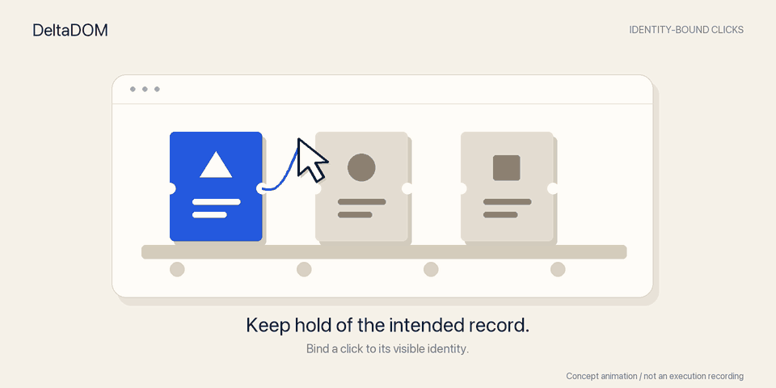

# DeltaDOM

[中文](README.md) · [English](README.en.md) · [日本語](README.ja.md) · [Français](README.fr.md)


**让点击跟着目标走。** 保存记录的可见身份，在真实点击过程中继续核对。

[概念动图](#常见场景别把隔壁工单关掉) · [本地试用](docs/BINDING-PREVIEW.md) · [实测与边界](benchmarks/BINDING-V9-RESULTS.md)

> **私密研发中（2026-10-23）。** 0.4 已停止公开分发；以下体验包入口仅供已有仓库访问权限的人使用。当前尚未证明端到端竞争优势，新的方向、负结果与继续投入标准见[研发决策](docs/DIRECTION.md)。未经项目所有者重新明确授权，不恢复公开。

最新本地预览 **0.5.0.dev9** 研究“列表变了，还能否点对原来的记录”：可以用 Option/Alt 点击保存一个目标，并在真实输入事件中再次核对。已完成独立目录的免编译安装和浏览器演示；固定场景及七站全部按钮对比已完成，观察到局部能力差异；尚未获得通用 Browser Use 替代品的证据。[直接试用说明](docs/BINDING-PREVIEW.md) · [接口与限制](docs/ACTION-BINDING.md)。源代码与图文已同步到私密仓库；预编译体验包尚未上传 GitHub Releases，下面的 0.4 下载包不包含这些新能力。

此前原型研究“断线后怎样避免重复提交”：已实现对象级未决写入隔离和请求转发防重放。真实浏览器故障诊断出现一项范围有限的恢复收益，也保留了合法重复操作被误拦等反例；尚不能作为通用保护层。见[使用方法](docs/RECOVERY-V7-V8.md)、[固定样本与强基线结果](benchmarks/RECOVERY-V7-V8-RESULTS.md)。原型尚未纳入 0.4 发布包。

**网页哪里变了，一步一步查清楚。**

[下载旧版体验包](https://github.com/Eman0n911/deltadom/releases/tag/v0.4.0) · [安装说明](START_HERE.md) · [实测比较](benchmarks/RECORDING-RESULTS.md) · [Python SDK](docs/SDK.md)

DeltaDOM 记录浏览器看到的页面内容，显示每一步的变化，出错后可以离线恢复先前记录。适合检查自动化流程、排查浏览器智能体为什么点错，以及保存动态页面的变化过程。

**0.4 是实验版。** 已验证 Apple 芯片 Mac 的免编译安装。演示不需要 API Key、模型账号或编程经验。

## 新原型：先看实际点击

### 常见场景：别把隔壁工单关掉

待处理列表一直在刷新。你选中了那张工单，它换位置时继续跟随；输入期间发现
记录身份改变，就暂停这次点击，留待重新检查。



*插画与动图用于表达机制，不是执行录像或效果保证。*
[静态版本](docs/assets/brand/identity-motion-still.png) · [真实浏览器演示与限制](docs/TICKET-QUEUE-STORY.md)

### 打开本地预览

使用本地交付的 **DeltaDOM-0.5.0.dev9-macosx_11_0_arm64.zip**，解压后双击
**Start DeltaDOM.command**。它会安装预编译程序并打开真实浏览器演示，无需模型账号。
此文件尚未上传 GitHub；下面的旧版下载地址不包含新原型。

在新体验包目录中，也可以保存自己的一个点击目标；将 `https://example.com` 替换为目标网页：

```sh
python3 run.py bind https://example.com --output action.json
python3 run.py bound-click action.json
```

第一步在浏览器中按住 Option/Alt 点击选取；第二步按记录身份执行一次真实点击，
并保留浏览器供你核对结果。发现身份改变就停止，没有自动重试，也不把点击等同于
业务成功。[详细使用步骤](docs/BINDING-PREVIEW.md)。

普通排序时，本版与强简单上下文核对在 281 个按钮上打平；11 种固定输入场景分别
使用普通与要求可信输入的处理器测试，每种处理器下，Browser Use 原生点击与人工
点击前核对各有 6 类错误效果，本版降为 2 类。
这不是完整任务成功率。[协议、强基线、全部反例与结果](benchmarks/BINDING-V9-RESULTS.md)。

## 旧版 0.4：观察录制体验

1. [下载并解压 Mac 体验包](https://github.com/Eman0n911/deltadom/releases/download/v0.4.0/DeltaDOM-0.4.0-macosx_11_0_arm64.zip)。需要 Python 3.12+（或 uv）与 Google Chrome。
2. 双击 **Start DeltaDOM.command**，或在解压目录运行 `python3 install.py`。
3. 观看真实浏览器完成填表、排序、选择商品和刷新；终端应显示 **Verified 8/8**。

不需要 Rust、Node.js 或编译器。首次安装联网下载依赖，演示只访问自带的本地页面。遇到问题看[逐步安装说明](START_HERE.md)。不是独立桌面应用，尚未签名/公证。

```text
STEP                   FRAME   NODES  FULL BYTES  SENT BYTES  CHECK
initial                full      304      32,556       7,203  OK
unchanged              delta     304      32,556          76  OK
fill                   delta     304      32,560         117  OK
reorder                delta     304      32,576         638  OK
same_url_reload        full      304      32,556       7,203  OK
```

这是 0.3 捕获核心的真实演示片段；0.4 保留该编码并新增可校验的录制文件。[完整历史输出](artifacts/preview-demo-0.3.txt)。数字是本地样例的字节量，不是模型费用。

## 看看具体改了什么

演示后，在解压目录运行：

```sh
# 检查记录完整性；无需再启动浏览器
python3 run.py replay deltadom-output/demo.ddt

# 对比填写前后的变化
python3 run.py diff deltadom-output/demo.ddt --before 2 --after 3

# 恢复第 3 步，保存为可读 JSON
python3 run.py replay deltadom-output/demo.ddt --step 3 --output step-3.json
```

要录制自己的网页：

```sh
python3 run.py record https://example.com --count 30 --output example.ddt
```

在打开的独立浏览器里操作，DeltaDOM 每秒记录一次。记录只在本地保存，可能包含页面和表单隐私，分享前请检查。它不读取日常浏览器登录态。[录制、中断恢复与接入说明](docs/RECORDING.md)。

## 给现有智能体加上记录

在安装了 wheel 的 Python 环境中，保留现有 Browser Use 模型与动作逻辑：

```python
from deltadom import BrowserUseRecorder

with BrowserUseRecorder("agent.ddt") as recorder:
    await agent.run(on_step_end=recorder.on_step_end)
```

已验证 Browser Use **0.13.11** 的回调接口。记录每步最后一份模型输入、输出和动作结果；不改变模型收到的内容，也不代表捕获全部 provider 请求或重试。[接口边界](docs/RECORDING.md#接入已有-browser-use-智能体)。

也可以在 Playwright 上使用 `DeltaBrowser` 的语义节点差分、稳定 ID 操作与显式允许的 API 字段读取。[SDK](docs/SDK.md) · [示例](examples/observe.py)。

## 实测表现

| 对比 | 结果 | 范围 |
|---|---|---|
| 逐帧保存相同 Browser Use 输出 | 记录体积减少 **48.7%–59.1%** | 对比独立 zlib 压缩+相同校验；既有页面记录 |
| 恢复原始内容 | **450/450 逐字一致** | 3 种观察来源，150 份/种 |
| 整段 gzip 归档 | **gzip 更小** | 只需任务结束后备份，优先 gzip |
| 模型费用、端到端成功率 | **未证明提升** | 本版记录回调不改变模型输入 |

[协议、所有结果和负结果](benchmarks/RECORDING-RESULTS.md)。旧观察层对比中，原生 agent-browser 增量在公开页面仍更短，Browser Use 原生 DOM 更快。不会把流式存储收益写成“超越主流智能体”。

## 选哪个工具

- 想让 AI 自主完成网页任务：[Browser Use](https://github.com/browser-use/browser-use)。
- 想从终端控制浏览器：[agent-browser](https://github.com/vercel-labs/agent-browser)。
- 想增量记录页面、逐字段检查变化、校验并恢复观察：试用 DeltaDOM，可配合现有工具使用。

本项目的记录格式使用标准 zlib 和上一帧字典，优势来自校验、增量记录与恢复流程的组合；不是新的压缩算法，也不宣称其他工具没有回放能力。

## 范围与限制

- V9 一次保存、重放一个点击，不负责完整任务规划。当前仅支持顶层常见 HTML 控件，重放网址须与保存时完全一致；变化检测仍有漏拦，不能撤销较早处理函数的副作用，也不确认服务器业务结果。
- “恢复一致”指捕获的语义节点或写入的原生文本，不是完整 HTML、视频或整个浏览器状态。Playwright 捕获不包含 iframe 内部、closed shadow 或 canvas 像素。
- 默认页面观察包含 60 ms 稳定窗口；可显示未稳定警告，不能保证网页未来不再更新。
- 单步录制最大 16 MiB，包含历史与 base64 截图的消息数组可能自然超限。`BrowserUseRecorder` 此时保存步号、消息数和字节数的省略占位记录，不中断智能体；回放报告 `omitted_snapshots`，省略内容无法恢复。其他写入或序列化错误仍会抛出。损坏会拒绝；中断录制可用 `replay --recover` 恢复已验证前缀，明确标记未完整结束。
- Mac arm64 体验包已本地验证。其他平台的源码/构建检查不等于下载包已完成安装验证。

## 开发与贡献

[发布前验证](docs/VALIDATION-0.4.md) · [开发环境和测试](CONTRIBUTING.md) · [设计](docs/DESIGN.md) · [竞争方向与停止标准](docs/DIRECTION.md) · [更新记录](CHANGELOG.md)

MIT · [第三方声明](THIRD_PARTY_NOTICES.md)。欢迎带着可复现的页面和错误报告提交 issue；不要附带真实密码、cookie 或个人浏览记录。
