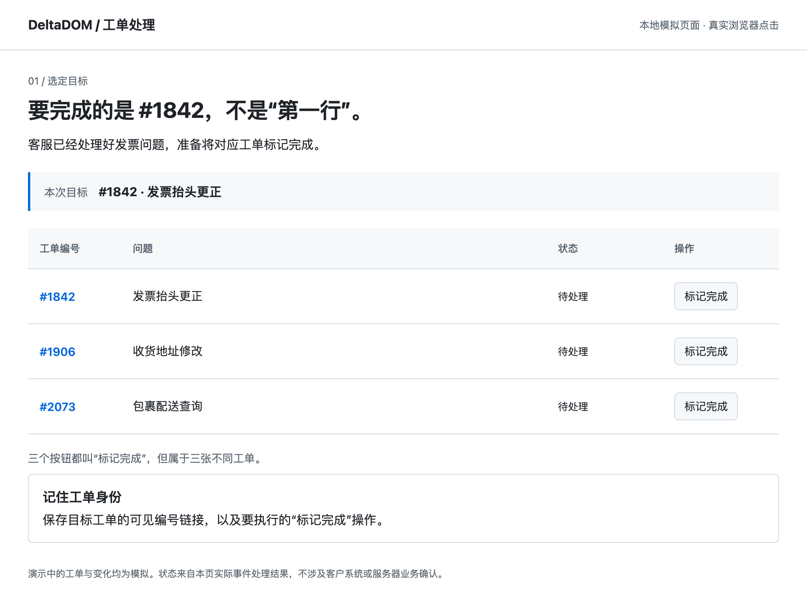
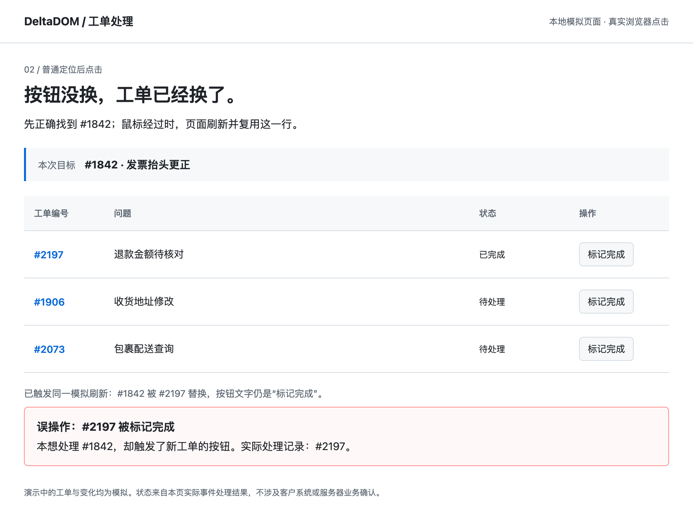
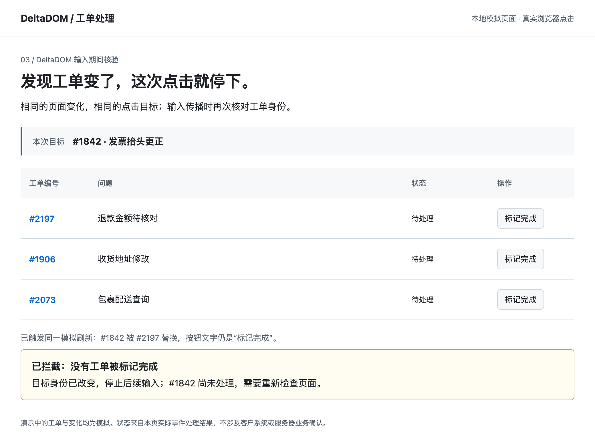
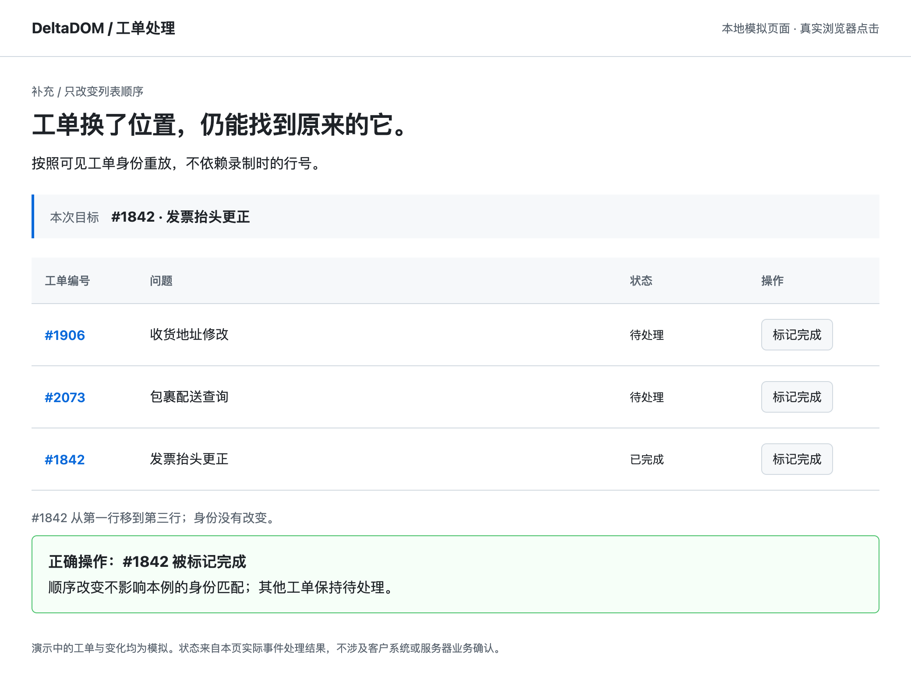

# 别把隔壁工单关掉。

**列表会刷新，要处理的工单不能跟着变。**

客服已经解决了 **#1842「发票抬头更正」**，准备让自动化点击“标记完成”。
同一张列表里，每条工单的按钮都叫这个名字。就在鼠标移过去时，页面刷新，
原来那一行换成了 **#2197「退款金额待核对」**。

按钮还在，文字也没变，但现在点下去，关掉的就是另一张工单。

DeltaDOM 的这项能力适合放在这一步：**记住要处理的是哪条记录，并在点击过程中
继续核对；身份变了，就停止后续输入。**

> 以下是可运行的本地模拟场景，不是真实客户案例。截图来自 Chrome 的真实点击；
> 顶部说明与底部结果栏是演示注释，工单状态由页面事件处理器实际更新。
> 本文用于说明机制，不是新增 benchmark 或完整客服流程的成功率。

## 1. 先记住工单，而不是它的位置

使用者选定 #1842 的“标记完成”。DeltaDOM 保存这个按钮与可见工单编号链接的
关系。它不需要使用者手写页面选择器，也不会自行判断这张工单是否已经解决。

**人或现有智能体决定处理什么；DeltaDOM 负责重放这一次已选定的点击。**

## 2. 普通核对的空隙：找到时正确，点下去时已变化

这个演示里的普通定位器已经按 #1842 的链接精确找到了按钮，并非盲点第一行。
但页面在鼠标经过时复用该行，把它换成 #2197。真实点击随后触发了新工单的
处理函数，#2197 被标记完成。

问题发生在“核对目标”之后。把点击前的检查做得更仔细，也不等于点击过程中
页面不会再变。

## 3. DeltaDOM：检查延续到真实输入过程中

同样的页面、同样的替换时机。DeltaDOM 在输入事件传播时重新核对记录，发现
#1842 已经变成 #2197，拦截后续点击。本例中，没有工单被标记完成。

**这次操作被阻止，不代表原任务已完成。** #1842 仍需重新检查与处理；工具不会
自动重试，也不会把一次受检点击直接报告成服务器业务成功。

## 只是排序变化，就继续找原工单

如果 #1842 只是从第一行移到第三行，它的身份仍然相符且唯一，就可以继续点击它。
这个演示中，只有 #1842 变为“已完成”，其他工单保持待处理。

普通排序并不是独有优势：强简单上下文核对也能做到。真正值得考虑这项保护的
场景，是**需要保留真实鼠标输入，而且页面在输入期间仍可能改变记录**。

## 我们已经验证到哪一步

| 验证 | 观察到的结果 | 可以说明什么 |
|---|---|---|
| 固定七站、14 个视图的全部 281 个按钮，额外施加列表重排 | Browser Use 原生历史重放：185 正确、94 错绑、2 未点击；V9 与强简单上下文核对均为 279 正确、0 错绑、2 未点击 | 身份重放相对原生历史匹配有收益；普通排序上与强简单方案打平 |
| 11 种固定输入场景，普通与要求可信输入的处理器分别测试 | 每种处理器下，原生点击与人工点击前核对各有 6 类错误效果；V9 为 2 类 | 输入期间核验有局部收益，仍有失败边界 |
| 本文四幅演示截图 | 普通点击误处理 #2197；保护分支拦截；重排后正确处理 #1842 | 用具体场景解释机制，不增加独立评估样本 |

同一段 JavaScript 内“核对再点击”也是强简单方案：普通处理器下它完成的正确
动作更多，但不能提供真实鼠标输入的全部语义。V9 以停止部分动作换取减少误操作，
并非在所有维度上更好。

如果页面在某个处理函数内部先写入，再让后续检查发现变化，或者页面外观完全
不变却执行另一项业务，这层保护仍可能失效。它没有服务端事务或撤销能力。

[查看完整协议、所有基线与反例](../benchmarks/BINDING-V9-RESULTS.md)。上述均是
组件验证，完整 BreakingWeb 自主任务优势仍未证明。

## 亲自试一下

本地预览包解压后，双击 **Start DeltaDOM.command**，可以观看同一机制的四种
浏览器行为；不需要模型账号或编译器。包内演示仍使用通用的“记录 A / B / Z”，
本文是它的工单场景表达，没有把预览包改成一个客服系统。

保存自己的目标时，按住 **Option / Alt** 点击选取，再按保存的身份执行一次。
目前一次保存、重放一个点击；不会录制整套客服流程。

[预览版使用说明](BINDING-PREVIEW.md) · [接口与边界](ACTION-BINDING.md)

开发者可在已安装项目与 Chrome 的环境中运行
`python scripts/render_ticket_story.py`，重新执行本地演示、核验四种结果并生成截图。
[原始点击回执](assets/ticket-queue/demonstration.json) ·
[工单页面源码](../examples/ticket_queue.html)

*私密研发材料；没有发布客户案例，也没有恢复公开分发。*
